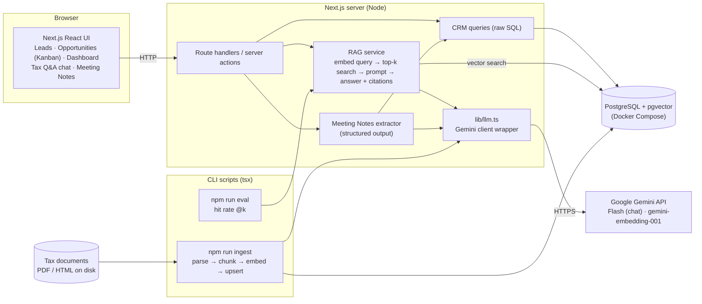
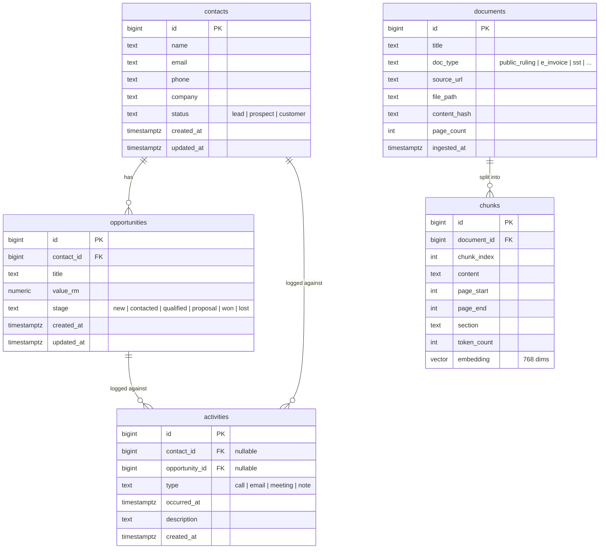

# Architecture

A lightweight CRM (Leads, Opportunities, Activity Log, Dashboard) plus a RAG Q&A module over Malaysian tax documents, and a Meeting Notes Extractor as the optional add-on (Option B).

> Status: design written in M0, before feature code. Sections marked _(M2)_, _(M3)_ etc. are filled in as those milestones land.

## 1. Overview

- **One Next.js app** holds the UI, the server-side API (route handlers / server actions) and the CLI scripts (ingest, eval).
- **One PostgreSQL database** with pgvector holds both the CRM data and the document chunks plus embeddings. It runs locally from Docker Compose.
- **One external service:** the Google Gemini API, used for both chat (Gemini Flash) and embeddings (`gemini-embedding-001`). Every model call goes through `lib/llm.ts`, so prompts and calls are easy to find.
- **No auth:** a single hardcoded user, as the brief allows.

## 2. Component diagram

**Main flows**
- **CRM:** browser → route handler / server action → SQL → Postgres.
- **Ingestion (offline):** `npm run ingest` reads the documents on disk, splits them into chunks with page/section metadata, embeds them via Gemini, and upserts into `documents` + `chunks`.
- **Tax Q&A:** question → embed → top-k cosine search in pgvector → grounded prompt with numbered chunks → Gemini Flash → answer with citations, or "not in the documents".
- **Evaluation:** `npm run eval` runs a fixed question set through the same retrieval code and reports hit rate @k.
- **Meeting Notes:** pasted notes → Gemini with a JSON schema → user reviews and edits → confirm writes contacts and activities.

## 3. Stack choice

The brief's preferred stack, kept as local as possible. A reviewer needs Node, Docker and a free Gemini API key.

| Layer | Choice | Why |
|---|---|---|
| App | Next.js (App Router) + TypeScript, Tailwind + shadcn/ui | Brief's preferred stack. One app and one language for UI, API and scripts. |
| Database | PostgreSQL + pgvector in one Docker Compose service (`pgvector/pgvector` image) | The brief's preferred vector store. CRM data and vectors in one DB; Docker is the only extra prerequisite. |
| DB access | `postgres` (postgres.js) + raw SQL; schema in `db/schema.sql`, loaded on first container start | No ORM or migration tool. Vector search is raw SQL anyway, and plain SQL keeps the retrieval query easy to read. Schema changes: reset the DB volume. |
| LLM | Gemini Flash via `@google/genai` | Named in the brief, has a free tier with no card. |
| Embeddings | `gemini-embedding-001`, output reduced to 768 dims | Same key as the LLM. pgvector's HNSW index supports up to 2,000 dims; the model's default is 3,072. |
| Ingestion | TypeScript script run with `tsx` | Same runtime as the app. _(M2: confirm PDF page extraction quality in Node; Python is the fallback.)_ |
| Deploy | None; a screen recording instead | Keeps everything local. |

**Alternatives considered**
- **Local LLM via Ollama:** the brief lists API providers, reviewers would have to download several GB, and small local models follow citation and refusal instructions less reliably.
- **PGlite (Postgres in WASM):** one process per data directory, so the ingest script and the dev server would fight over the DB.
- **SQLite + sqlite-vec:** works, but moves away from the preferred pgvector for no real gain.
- **Supabase CLI locally:** runs about 10 containers when we only need Postgres.
- **ORM (Drizzle / Prisma):** adds a layer and a migration tool for five tables; the vector query would be raw SQL regardless.

## 4. Data model

Full DDL: [`db/schema.sql`](db/schema.sql).

**Design notes**
- **One `contacts` table for "Leads".** The brief's Leads have a status of Lead / Prospect / Customer, while the dashboard counts "total contacts" and opportunities link to "contacts". So it's one entity with a `status`; the UI calls the page "Leads".
- **Enums as `text` + `CHECK`.** Maps directly onto TypeScript union types and is easy to read in the DDL.
- **Money as `numeric(12,2)` in `value_rm`.** Exact decimals, no floating-point rounding.
- **Activities link to a contact, an opportunity, or both.** Two nullable foreign keys with a `CHECK` that at least one is set; simpler to query than a polymorphic `(target_type, target_id)` pair.
- **Deleting a contact deletes its opportunities and activities** (`ON DELETE CASCADE`). The UI confirms first and says what else will be deleted. See §8 for the more realistic alternative.
- **Dashboard metrics:** total contacts = all `contacts` rows; open opportunities = stage not in (`won`, `lost`); total value = sum of `value_rm` (open pipeline value shown too); recent activity = latest `activities` by `occurred_at`.
- **RAG tables:** `documents` stores one row per source file with a content hash so re-ingesting unchanged files is skipped. `chunks` keeps page range and section heading for citations, and an HNSW index with cosine distance on `embedding`. _(M2 may refine these columns.)_

## 5. RAG design _(M2–M3)_

To be written as the module is built. Will cover: document set and sources, parsing, chunking strategy and size, embedding model and task types, vector index, retrieval settings (top-k, metadata filter / rerank), prompt design, citation format, hallucination guard ("not in the documents"), and error handling.

## 6. Meeting Notes Extractor design _(M5)_

To be written in M5. Will cover: extraction schema, prompt, schema enforcement and validation, the review-and-edit step, how contacts are matched (create vs update), and error handling.

## 7. Evaluation _(M4)_

To be written in M4: the question set with expected source documents, hit rate @k, and what we learned.

## 8. What I would do differently with more time

- **Archive contacts instead of deleting them.** Real CRMs (HubSpot, Salesforce) move deleted records to a recycle bin so sales history can be restored. Here, deleting a contact permanently deletes its opportunities and activities, which keeps the build simple. With more time:
  - add `archived_at timestamptz` to `contacts` and archive instead of delete;
  - read all CRM data through `active_contacts` / `active_opportunities` views, so no query can forget to hide archived rows (including the dashboard totals and the Kanban board, where an archived contact's opportunities shouldn't count);
  - an "Archived" filter with a Restore button;
  - a real permanent delete for erasure requests under Malaysia's PDPA, since archiving alone doesn't remove personal data.
