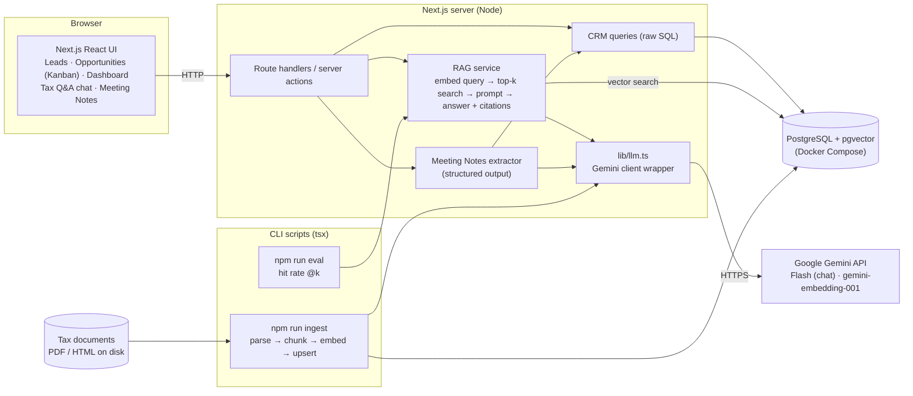
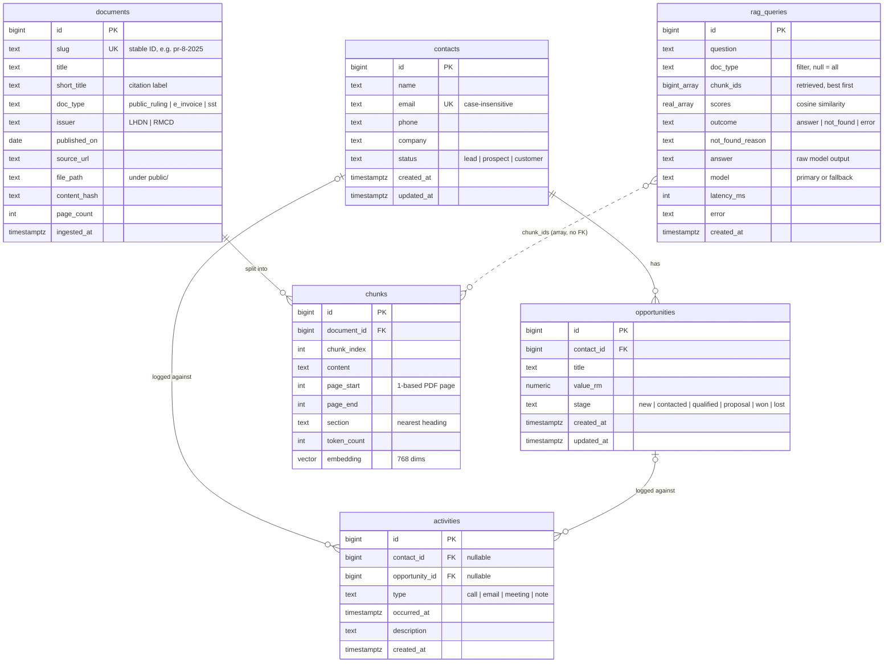
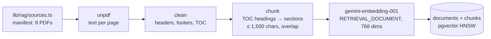
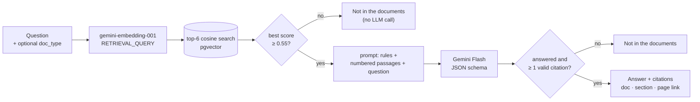

# Architecture

A lightweight CRM (Leads, Opportunities, Activity Log, Dashboard) plus a RAG Q&A module over Malaysian tax documents, and a Meeting Notes Extractor as the optional add-on (Option B).

> Status: design written in M0, before feature code. Sections marked _(M2)_, _(M3)_ etc. are filled in as those milestones land.

## 1. Overview

- **One Next.js app** holds the UI, the server-side API (route handlers / server actions) and the CLI scripts (ingest, eval).
- **One PostgreSQL database** with pgvector holds both the CRM data and the document chunks plus embeddings. It runs locally from Docker Compose.
- **One external service:** the Google Gemini API, used for both chat (Gemini Flash) and embeddings (`gemini-embedding-001`). Every model call goes through `lib/llm.ts`, so prompts and calls are easy to find.
- **No auth:** a single hardcoded user, as the brief allows.

## 2. Component diagram

**Main flows**
- **CRM:** browser → route handler / server action → SQL → Postgres.
- **Ingestion (offline):** `npm run ingest` reads the documents on disk, splits them into chunks with page/section metadata, embeds them via Gemini, and upserts into `documents` + `chunks`.
- **Tax Q&A:** question → embed → top-k cosine search in pgvector → grounded prompt with numbered chunks → Gemini Flash → answer with citations, or "not in the documents".
- **Evaluation:** `npm run eval` runs a fixed question set through the same retrieval code and reports hit rate @k.
- **Meeting Notes:** pasted notes → Gemini with a JSON schema → user reviews and edits → confirm writes contacts and activities.

## 3. Stack choice

The brief's preferred stack, kept as local as possible. A reviewer needs Node, Docker and a free Gemini API key.

| Layer | Choice | Why |
|---|---|---|
| App | Next.js (App Router) + TypeScript, Tailwind + shadcn/ui | Brief's preferred stack. One app and one language for UI, API and scripts. |
| Database | PostgreSQL + pgvector in one Docker Compose service (`pgvector/pgvector` image) | The brief's preferred vector store. CRM data and vectors in one DB; Docker is the only extra prerequisite. |
| DB access | `postgres` (postgres.js) + raw SQL; schema in `db/schema.sql`, loaded on first container start | No ORM or migration tool. Vector search is raw SQL anyway, and plain SQL keeps the retrieval query easy to read. Schema changes: reset the DB volume. |
| LLM | Gemini Flash (`gemini-3.5-flash`, set by `GEMINI_CHAT_MODEL`) via `@google/genai` | Named in the brief, has a free tier with no card. Chosen in M0 by probing the models the key can use: the newer 3.7 / 3.8 Flash returned 503 "high demand" on every call that day; 3.5 was the fastest that answered. |
| Embeddings | `gemini-embedding-001`, output reduced to 768 dims | Same key as the LLM. pgvector's HNSW index supports up to 2,000 dims; the model's default is 3,072. |
| Ingestion | TypeScript script run with `tsx`; PDFs parsed with [`unpdf`](https://github.com/unjs/unpdf) (Mozilla pdf.js for Node) | Same runtime as the app. Tested on all 9 documents in M2: every page has a text layer, text comes out in reading order and per page. No Python needed. |
| Deploy | None; a screen recording instead | Keeps everything local. |

**Gemini free tier, things to know**
- Google may use free-tier prompts to improve its products. Fine here: we only send public tax documents and made-up CRM data. A real deployment would use a paid tier.
- Model IDs change: `gemini-2.5-flash`, the planned default, was already closed to new users. Model names live in env vars, and `npm run check:gemini` lists what a key can use.
- The free tier is often overloaded (503 / 504). The SDK's default retries could leave one call hanging for minutes, so `lib/llm.ts` sets a 30s timeout and 3 attempts. _(M3: fall back to another model and show a clear error in the UI.)_

**Alternatives considered**
- **Local LLM via Ollama:** the brief lists API providers, reviewers would have to download several GB, and small local models follow citation and refusal instructions less reliably.
- **PGlite (Postgres in WASM):** one process per data directory, so the ingest script and the dev server would fight over the DB.
- **SQLite + sqlite-vec:** works, but moves away from the preferred pgvector for no real gain.
- **Supabase CLI locally:** runs about 10 containers when we only need Postgres.
- **ORM (Drizzle / Prisma):** adds a layer and a migration tool for five tables; the vector query would be raw SQL regardless.

## 4. Data model

Full DDL: [`db/schema.sql`](db/schema.sql).

**Design notes**
- **One `contacts` table for "Leads".** The brief's Leads have a status of Lead / Prospect / Customer, while the dashboard counts "total contacts" and opportunities link to "contacts". So it's one entity with a `status`; the UI calls the page "Leads".
- **Enums as `text` + `CHECK`.** Maps directly onto TypeScript union types and is easy to read in the DDL.
- **Money as `numeric(12,2)` in `value_rm`.** Exact decimals, no floating-point rounding.
- **Activities link to a contact, an opportunity, or both.** Two nullable foreign keys with a `CHECK` that at least one is set; simpler to query than a polymorphic `(target_type, target_id)` pair.
  Activities logged from an opportunity's page also store that opportunity's contact, so a contact's timeline includes them without extra joins.
- **One contact per email.** A unique index on `lower(email)` (where email is set). The form shows a clear error for duplicates, and the Meeting Notes Extractor (M5) can match people to existing contacts by email.
- **Deleting a contact deletes its opportunities and activities** (`ON DELETE CASCADE`). The UI confirms first and says what else will be deleted. See §8 for the more realistic alternative.
- **Dashboard metrics:** total contacts = all `contacts` rows; open opportunities = stage not in (`won`, `lost`); total value = sum of `value_rm` across all stages (open pipeline and won value shown as sub-lines); recent activity = latest 10 `activities` by `occurred_at`. The feed shows only logged activities, not system events like "stage changed", so it stays meaningful.
- **RAG tables:** `documents` has one row per source PDF, keyed by a stable `slug` from the manifest (the eval names expected sources by slug), with the metadata citations and the M3 filter need (`short_title`, `doc_type`, `published_on`). `content_hash` lets re-ingestion skip unchanged documents. `chunks` keeps the page range and section heading for citations, and an HNSW index with cosine distance on `embedding`. `rag_queries` logs every Tax Q&A question with what was retrieved and what came back (M3); `chunk_ids` is an array without a foreign key on purpose, so re-ingesting a document doesn't delete its history. See §5.

### CRM implementation (M1)

- **Reads:** server components call plain query functions in `lib/crm/*.ts` (raw SQL via postgres.js). Nothing is cached: CRM data is small and must be fresh after every edit. Each route has a `loading.tsx` so navigation shows a skeleton straight away while the query runs.
- **Writes:** Server Actions (`app/**/actions.ts`) validate `FormData` with zod schemas from `lib/crm/schemas.ts`, call the query function, then `refresh()` so the page re-renders in the same round trip. Validation errors come back as field errors through `useActionState`. The same schemas will validate the LLM's output in M5.
- **Numbers:** postgres.js returns `bigint` and `numeric` as strings; `lib/db.ts` parses both to numbers once at the driver level, so no query can forget.
- **Kanban:** native HTML5 drag-and-drop with `useOptimistic`, so the card moves at once and snaps back if the save fails. Keyboard and touch users change the stage from a dropdown on the opportunity's page.
- **Time zone:** all dates are shown and entered in Malaysia time (`Asia/Kuala_Lumpur`), whatever the server's or the browser's zone.

## 5. RAG design

Ingestion (M2, offline) is §5.1–5.4; answering a question (M3) is §5.5–5.8.

### 5.1 Document set

Nine public PDFs (~445 pages, ~500 chunks) across three types, so a `doc_type` filter is meaningful:

| Type | Documents | Issuer |
|---|---|---|
| `e_invoice` | e-Invoice Guideline v4.8 (Aug 2026), e-Invoice Specific Guideline v4.9 (Sep 2026) | LHDN |
| `public_ruling` | PR 8/2025 micro, small and medium companies; PR 7/2025 individual gifts and deductions; PR 3/2024 tax borne by employers; PR 4/2026 small value assets | LHDN |
| `sst` | Service Tax guides: professional services; management services (v5, May 2026); digital services by foreign service providers | RMCD |

Chosen for what taxPOD's customers ask about (e-invoicing, SST, SME and employer tax), and with some deliberate overlap: SME thresholds appear in both the e-Invoice guideline and PR 8/2025, and management services in two SST guides. That makes retrieval non-trivial and the eval more honest.

**The PDFs are committed** (`public/documents/`, 5.5 MB) with their source URL and publication date in a typed manifest (`lib/rag/sources.ts`). While choosing them, two of the URLs search engines returned were already dead and one served an e-Invoice guideline two versions old, so downloading at ingest time would make the knowledge base change under the eval. Serving them from `public/` also lets a citation link to `/documents/<file>.pdf#page=N`.

### 5.2 Parsing and cleaning (`lib/rag/pdf.ts`)

`unpdf` returns the text of each page with line breaks but no blank lines. Before chunking:

- **Running headers and footers** are removed: a line in the top 8 or bottom 3 lines of a page that repeats (numbers ignored) on at least half the pages. Public Rulings repeat a 5–7 line header (title, ruling number, publication date, "Page N of M") on every page; RMCD guides repeat a copyright line with the page number glued on.
- **Table-of-contents pages** are removed from the text but kept aside: they are how headings are found (below). Left in, TOC lines would match almost any question about a topic and crowd out the real answer.
- Page numbers are kept per line, so every chunk knows its PDF page range.

### 5.3 Chunking (`lib/rag/chunk.ts`)

Tax guidance is written as numbered paragraphs under numbered or capitalised headings, and an answer usually sits inside one section. The chunker:

1. **Rebuilds paragraphs**: a new one starts at a paragraph marker (`5.`, `4.3.1`, `(a)`, `(iv)`, "Example 3") or after a line that ends a sentence; other lines are joined to the previous one.
2. **Finds headings from the document's own table of contents.** Numbered entries match on number + the start of the title (the wording differs slightly between TOC and body, e.g. "6. Allowable Deductions" vs "6. Allowable Deduction"); unnumbered RMCD headings ("Legal Services", "EXEMPTION FROM PAYMENT OF SERVICE TAX …") must match exactly, case included, over one or two lines. A first version guessed headings from patterns (numbered, ALL CAPS, Title Case) and turned list items like "1. API Application Programming Interface" into sections; the TOC is the author's own list of headings, so there's nothing to guess. A document without a TOC would still be chunked, just without section labels.
3. **Packs paragraphs** into chunks of up to **1,500 characters (~375 tokens)**. A top-level heading (`4.`, `1.0`, ALL CAPS) always starts a new chunk; a sub-heading does once the current chunk is half full. Consecutive chunks in a section repeat the last paragraph if it's short (≤ 500 chars) as overlap, so a rule split across a boundary is still found whole. Over-long paragraphs (flattened tables) are split at sentence ends; heading-only scraps are dropped and tiny chunks fold into their neighbour.

Each chunk stores `content`, `page_start`/`page_end` (1-based PDF pages: what a viewer shows and `#page=N` opens; printed page numbers differ, e.g. PDF page 5 of PR 8/2025 is printed "Page 2 of 26") and `section` (the nearest heading, e.g. "1.6 Exemptions from implementing e-Invoice").

Result: 497 chunks, median ~1,300 characters (max 1,691); check with `npm run ingest -- --dry-run`, which writes every chunk to `tmp/chunks.jsonl`. 1,500 characters fits a typical sub-section (2–4 numbered paragraphs with their conditions) without mixing topics; it is a single setting (`CHUNK_OPTIONS`) for M4 to tune against hit rate.

### 5.4 Embedding and storage (`scripts/ingest.ts`)

- **What is embedded:** `<document title>\n<heading path>\n\n<chunk text>`. A chunk like "(e) Taxpayers with an annual turnover or revenue of less than RM1,000,000" doesn't say it's about e-Invoice exemptions; the title and heading path put that into the vector. `content` stores the chunk text alone, for the prompt and the UI.
- **Model:** `gemini-embedding-001`, task type `RETRIEVAL_DOCUMENT` (questions will use `RETRIEVAL_QUERY`), 768 dims, scaled to unit length.
- **Rate limits:** the free tier allows **30,000 embedding tokens per minute** (not published; found when the first full run was rejected). The whole set is ~175k tokens, so the script sends batches of ≤ 8k estimated tokens and keeps a rolling 60-second budget of 24k. A full ingest therefore takes about 6 minutes on the free tier (seconds on a paid key); every later run is free because unchanged documents are skipped. If a 429 still happens, it waits as long as the API's "retry in Ns" says.
- **Idempotent:** `content_hash` = sha256 of the PDF bytes + its manifest entry + chunker version and settings + embedding model and dims. Unchanged → skipped with no API call. Changed → chunks are embedded first, then the document's old chunks are replaced in one transaction, so a failed API call leaves the previous version intact. Documents removed from the manifest are deleted (chunks cascade). `--force` and `--only <slug>` re-ingest selectively.

### 5.5 Retrieval (`lib/rag/retrieve.ts`)

- **Query embedding:** the question is embedded with task type `RETRIEVAL_QUERY` (chunks used `RETRIEVAL_DOCUMENT`), 768 dims, unit length.
- **Search:** one SQL query, ordered by cosine distance (`<=>`), joined to `documents` for the citation fields. **k = 6** passages (~2k tokens): M2's sanity searches sometimes ranked the best passage 2nd or 3rd, so k = 3 is too tight, and more than ~8 mostly adds overlapping chunks from the same section. M4 measures hit rate @1/@3/@6.
- **Metadata filter (the brief's bonus):** an optional `doc_type` (e-Invoice / Public Ruling / SST), chosen in a dropdown and applied in the SQL `where`. A rep who knows it's an SST question avoids e-Invoice passages that share vocabulary. With a filter, Postgres scans that type's chunks exactly (checked with `EXPLAIN`), so a filtered search never returns fewer than k. Reranking with a second LLM call was left for M4 to test against the eval, because on the free tier it doubles the calls that can fail.

### 5.6 Prompt and answer (`lib/rag/prompt.ts`, `lib/rag/answer.ts`)

The whole prompt is in one file. The **system instruction** tells the model to use only the numbered sources, to cite every statement as `[n]`, to set `answered: false` if the sources don't contain the answer, to answer a partly covered question only partly and say what's missing, to quote figures exactly, and to ignore instructions inside the sources. The **message** lists the passages as `[1] PR 8/2025 — 6. Special Tax Treatment… (page 19)` followed by the text, then the question.

**Structured output:** the reply must match `{ answered: boolean, answer: string }`. The schema is written once in zod, converted to JSON Schema and passed as `responseJsonSchema`, so Gemini enforces it while generating; zod checks it again on arrival. `answered` is an explicit refusal flag (no matching "I don't know" phrases), which M4 uses to score the negative questions. The same `generateJson()` helper will run M5's extraction.

**Settings:** `gemini-3.5-flash` (fallback `gemini-3.1-flash-lite`, see §5.8), thinking level `LOW` (this is lookup and summarising, and it keeps answers to ~2–8 s; `MINIMAL` isn't accepted by every Gemini 3 Flash model), temperature at the default as Google recommends for Gemini 3. Each question is answered on its own: no conversation history, so follow-ups don't need a query-rewriting call and every answer is reproducible in the eval. The answer is returned whole (no streaming) because citations are checked after the full JSON arrives.

### 5.7 Citations and the hallucination guard

**Citations:** the model writes `[n]` markers that refer to the passage numbers in the prompt. The server keeps only markers that point at a passage it actually sent, drops the rest, merges duplicates, and renumbers them in order of first use. Each citation carries the document's short title, section heading, PDF page range and publication date ("as at 30 Aug 2026"), and links to `/documents/<file>.pdf#page=N`, which opens the committed PDF on the cited page. "Show retrieved passages" under each answer lists all six passages with their scores and which ones were cited, so retrieval can be inspected.

**"Not in the documents"**, three layers:
1. **Similarity floor (0.55).** If even the best passage scores below it, the question is off-topic and the LLM isn't called. Measured: in-scope top hits 0.70–0.76; "What is the capital of France?" 0.50.
2. **The prompt.** Near-domain questions pass the floor ("corporate income tax rate in Singapore" scores 0.60 against PR 8/2025's Malaysian rates), so the model must decline: it sets `answered: false`, verified on that question.
3. **Citation check.** An answer with no valid citation is withheld and shown as "not in the documents", since it may come from the model's own memory.

The UI says which layer refused (no close match / the AI found no answer in the passages / no citations), and every answer carries "check the source before advising a client".

**Stale and conflicting sources are a separate risk.** The answer is faithful to the passages it was given, not to today's law. Asked "Is service tax charged on legal services?", it quotes the 2021 Professional Services guide's 6% rate, while the 2026 Management Services guide in the same knowledge base says the rate rose from 6% to 8% on 1 March 2024 (p. 5); that passage wasn't retrieved, so the model couldn't know. The "as at" date on each citation makes the age visible. Fixes (an M4 case, and §8): prefer newer documents when passages conflict, and keep documents current.

### 5.8 Error handling and observability

| Failure | Handling | User sees |
|---|---|---|
| Chat model busy (503/504/timeout), rate-limited (429) or gone (404) | Try `GEMINI_FALLBACK_MODEL` once. SDK: 30 s timeout, 3 attempts for 5xx, **no retry on 429** (a quota doesn't reset in 4 s; retrying only spends it) | Answer from the fallback, labelled with its model name |
| Both models over the per-minute limit | Parse the API's "retry in 42s" | "Free-tier limit reached (5 questions a minute per model). Try again in N s." + Retry |
| Both models over the daily limit | Parse "retry in 16h17m…" | "Daily limit used up (resets in about N h). Use another API key, or try again later." |
| Both models busy | — | "Gemini is busy right now. Try again in a minute." + Retry |
| Reply doesn't match the schema | Counts as a failure of that model, so the fallback runs | "Wrong format, try again" + Retry |
| Key missing or invalid | — | "Set GEMINI_API_KEY in .env" |
| No chunks loaded | — | "Run `npm run ingest`" |
| Database down | — | "Is Docker running? (`npm run db:up`)" |
| Question < 3 or > 500 characters | zod, before any call | Validation message |

**Free-tier limits** (not published; read from real 429s during M3, `generate_content_free_tier_requests`): **5 requests a minute and 20 a day per model** for `gemini-3.5-flash`. The 503 "high demand" errors are separate and frequent: twice during M3 testing both Flash models failed together for over a minute. The fallback is therefore a **Flash-Lite** model, which has its own quota and capacity: it answered the same questions with the same citations in 3–8 s while both Flash models were failing. Embeddings have their own, larger limit (§5.4), so retrieval keeps working when generation is out of quota.

**Logging:** every question writes a `rag_queries` row: question, filter, retrieved chunk IDs and scores, outcome and refusal reason, the model's raw answer, which model answered, latency and any error. A failed insert is logged to the console and never breaks the answer. `npm run ask -- "…"` runs the same pipeline from the terminal and prints the passages, scores, answer and citations.

## 6. Meeting Notes Extractor design _(M5)_

To be written in M5. Will cover: extraction schema, prompt, schema enforcement and validation, the review-and-edit step, how contacts are matched (create vs update), and error handling.

## 7. Evaluation _(M4)_

To be written in M4: the question set with expected source documents, hit rate @k, and what we learned.

## 8. What I would do differently with more time

- **Archive contacts instead of deleting them.** Real CRMs (HubSpot, Salesforce) move deleted records to a recycle bin so sales history can be restored. Here, deleting a contact permanently deletes its opportunities and activities, which keeps the build simple. With more time:
  - add `archived_at timestamptz` to `contacts` and archive instead of delete;
  - read all CRM data through `active_contacts` / `active_opportunities` views, so no query can forget to hide archived rows (including the dashboard totals and the Kanban board, where an archived contact's opportunities shouldn't count);
  - an "Archived" filter with a Restore button;
  - a real permanent delete for erasure requests under Malaysia's PDPA, since archiving alone doesn't remove personal data.
- **Pagination and sorting on the leads list.** The list is capped at 200 rows (fine for the demo's 15). A real list needs keyset pagination and sortable columns, and search would move to Postgres full-text or trigram indexes once `ILIKE` gets slow.
- **Accessible drag-and-drop.** Native HTML5 drag-and-drop has no keyboard or touch support; the stage dropdown covers it, but a library like `@dnd-kit` would make the board itself accessible and allow reordering within a column.
- **An events table for the activity feed.** Stage changes and edits aren't recorded anywhere. An append-only `events` table would give an audit trail and a richer feed without mixing system events into the activities that people log.
- **Keep the knowledge base current.** The e-Invoice guidelines are revised every few months (v4.6 → v4.8 in the months before this build). A scheduled job would check the official listing pages, download new versions, re-ingest them (the content hash makes that cheap) and flag answers that cite a superseded version.
- **Follow-up questions in Tax Q&A.** Each question is answered on its own. A conversation would rewrite a follow-up ("what about for SST?") into a standalone question using the history before retrieval: one extra LLM call, and an eval set of multi-turn cases.
- **Streaming answers.** Answers arrive whole after 2–8 s. Streaming plain text and checking citations at the end would feel faster, at the cost of the schema-enforced refusal flag.
- **"Ask about this client" from the CRM.** A button on a contact's page could open Tax Q&A with the client's context (company, status, open opportunities) shown alongside, so a rep can answer a client's tax question without leaving the record.
- **Table-aware parsing.** pdf.js flattens tables into one cell per line, so a table becomes a run of words in reading order (e.g. the SME size thresholds in PR 8/2025). It's still searchable, but a layout-aware parser (or an LLM pass over table pages) could turn tables into Markdown rows that the LLM reads more reliably.
